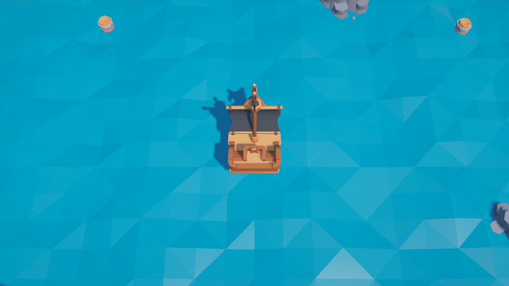

# Boat Game (working title)

A low-poly 3D sailing game made in Unity for our Game Design course.
You sail a small pirate ship around a sea map full of islands and rocks,
and collect floating barrels full of money. Small barrels near the start are
safe and worth **+10**. Big spinning barrels far out near the map edge are worth **+50**,
but a pirate ship patrols out there. If it catches you, your ship sinks.

> Midterm prototype. Not final art, no sound yet. See [docs/DEVLOG.md](docs/DEVLOG.md)
> for every development step and how it was done.

## How to run

1. Install **Unity 6000.4.7f1** (Unity 6.4) from Unity Hub.
2. Clone this repository and open the folder in Unity Hub (**Add > Add project from disk**).
3. Open `Assets/Scenes/SeaMap.unity` and press **Play**.

To regenerate the map after changing the builder code, use the menu
**Tools > Boat Game > Build Sea Map**.

## Controls

| Key | Action |
|---|---|
| Space / Enter | Start the game (on the start screen) |
| W / Up arrow | Sail forward (hold) |
| S / Down arrow | Slow down / reverse (hold) |
| A / D or Left / Right arrows | Steer |
| Mouse wheel | Zoom the camera |
| R | Restart the level |

## Goal

Collect all 28 barrels (22 x +10, 6 x +50, max **520** money) without getting caught.

- **Win:** every barrel collected.
- **Lose:** the pirate ship catches you. Your ship sinks, and you can press R to try again.
- **Safe zone:** inside the ring of red buoys around the start, the pirates will not follow you.
- The pirate ship patrols the outer sea, chases you when you get within about 25 units,
  and gives up if you get far enough away. It is a bit slower than you, so watch the
  red "PIRATES ARE CHASING YOU!" warning and run early.

The HUD at the top left shows your money, barrels collected and speed.

## Project structure

| Folder | Content |
|---|---|
| `Assets/Scenes/SeaMap.unity` | The prototype level |
| `Assets/Scripts/Ship/` | Ship movement and keyboard input |
| `Assets/Scripts/Ocean/` | Animated ocean and floating props |
| `Assets/Scripts/Camera/` | Top-down follow camera |
| `Assets/Scripts/Score/` | Money barrels and the player's wallet |
| `Assets/Scripts/Enemy/` | Pirate ship AI (patrol, chase, catch) |
| `Assets/Scripts/Game/` | Game flow: start, playing, win, lose, restart |
| `Assets/Scripts/UI/` | HUD and the start / win / lose screens |
| `Assets/Editor/SceneBuilders/` | Editor script that generates the map |
| `Assets/ThirdParty/KenneyPirateKit/` | 3D models (see credits) |
| `docs/DEVLOG.md` | Step-by-step development log |

The original Roll-a-Ball tutorial files (`Assets/Scenes/SampleScene.unity`,
`PlayerController.cs`, ...) are still in the project from the first commit.
They are not used by the game.

## Planned (not implemented yet)

- More enemies or enemy types, and tuning their speed after playtesting
- Spending money on ship upgrades
- Time limit or level progression
- Sound effects and music
- Main menu

## Credits

- **3D models:** [Pirate Kit](https://kenney.nl/assets/pirate-kit) by Kenney (www.kenney.nl), CC0 license.
  See `Assets/ThirdParty/KenneyPirateKit/License.txt`.
- **Engine:** Unity 6 with the Universal Render Pipeline and the Input System package.
- Code written by the team with help from an AI assistant (Claude by Anthropic).
  The ocean, camera and ship scripts were adapted from our own earlier pirate prototype.
