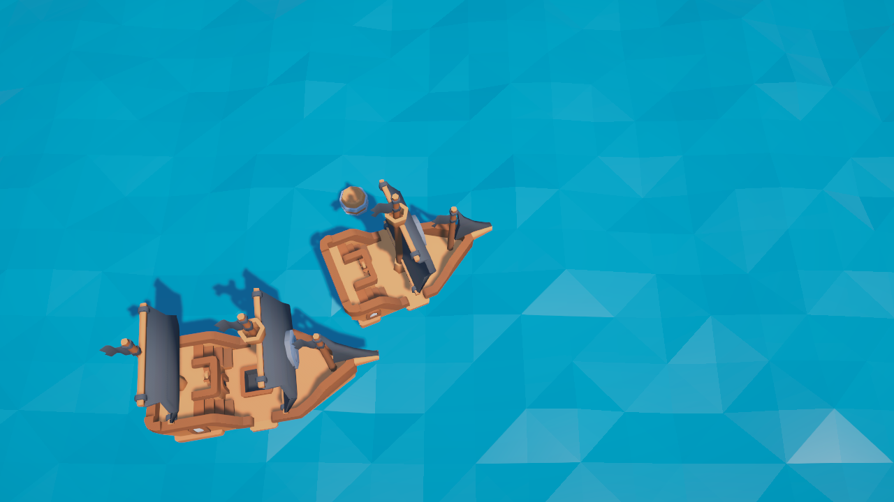
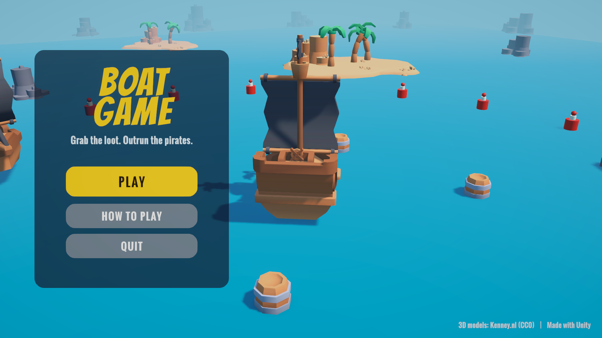
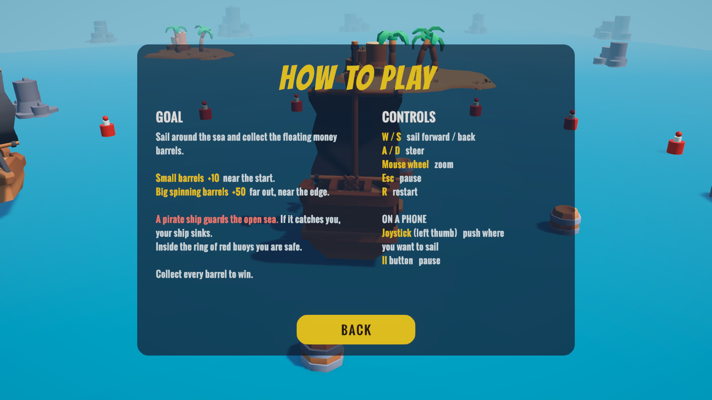
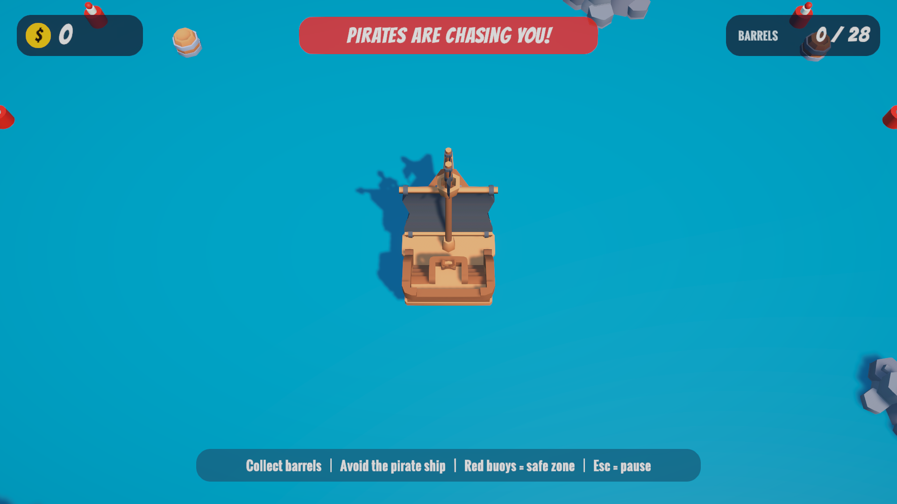
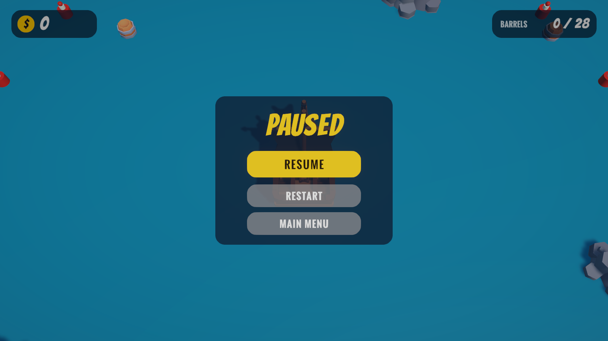
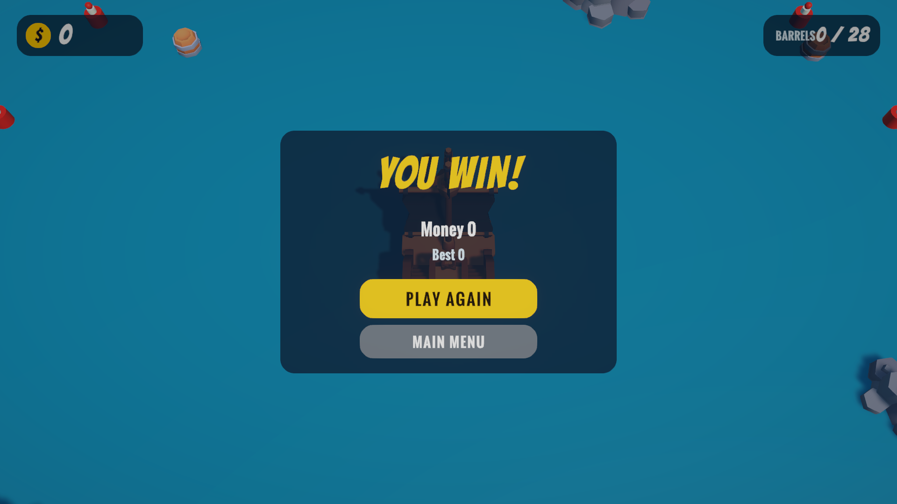

# Development Log

This log records every step of the prototype: what changed, how it was done, and
which files were touched. Each step matches one git commit on the branch
`feature/ship-map-barrels`, so you can open the commit to see the exact diff.

---

## Step 0 - Upgrade the project to Unity 6000.4.7f1

**Goal:** open the project in the Unity version the team has installed (Unity 6.4).

**How it was done:**
- The repository was created with Unity `6000.3.8f1`. It was opened with Unity
  Hub in `6000.4.7f1`, and Unity upgraded the project automatically.
- Unity bumped the package versions to the ones that ship with 6.4
  (URP 17.4.0, Input System 1.19.0, AI Navigation 2.0.12, ...).
- No game code changed in this step.

**Files:** `ProjectSettings/ProjectVersion.txt`, `Packages/manifest.json`,
`Packages/packages-lock.json`, `Assets/Settings/UniversalRenderPipelineGlobalSettings.asset`,
`ProjectSettings/EditorBuildSettings.asset`.

**Team note:** everyone must open the project with **Unity 6000.4.7f1** from now on.
Opening it with an older version can break the packages.

---

## Step 1 - Bring reusable parts from our pirate prototype

**Goal:** reuse what already worked in our earlier pirate prototype
(`D:\Unity Project\PirateGame\My project (3)`) instead of starting from zero.

**What was copied as-is:**
| File | What it does |
|---|---|
| `Assets/ThirdParty/KenneyPirateKit/` | Low-poly 3D models (ships, barrels, islands, palms, rocks) by Kenney, CC0 license (`License.txt` included). Copied with their `.meta` files so Unity keeps the same asset IDs. |
| `Assets/Scripts/Ocean/Ocean.cs` | Builds a low-poly water mesh and moves its vertices with 4 summed sine waves. `HeightAt(position)` returns the water height so other objects can float. The mesh follows the ship, so the sea looks endless. |
| `Assets/Scripts/Ocean/Bobber.cs` | Makes a small object (a barrel) sit on the waves and slowly spin. |
| `Assets/Scripts/Camera/TopDownCamera.cs` | Camera that looks down at the ship from a fixed angle, follows it smoothly, looks a bit ahead of where the ship is going, and zooms with the mouse wheel. |

**What was simplified (rewritten from the pirate version):**
| File | Change |
|---|---|
| `Assets/Scripts/Ship/ShipController.cs` | The pirate version used 3 "sail levels" you step through with W/S. For this game we wanted simple controls, so the sail levels were replaced by a continuous `Throttle` (-1..1): hold W to speed up, release to slow down, hold S to reverse. Added `mapRadius` so the ship cannot leave the play area. Kept the floating code (the ship model tilts with the waves and leans into turns) and the obstacle push-out (the ship slides off islands and rocks). |
| `Assets/Scripts/Ship/PlayerShipInput.cs` | Removed the cannon keys (Q/E/T). Now: W/S or arrows = move, A/D or arrows = steer, R = restart the level. Uses the new Input System, which the project already had. |

**Editor tooling (not part of the game):**
- `Assets/Editor/ClaudeBridge/ClaudeBridge.cs` + `ClaudeTools/bridge.py`: a small
  editor-only HTTP server (localhost only, protected by a token kept in the
  git-ignored `UserSettings/` folder). The AI assistant (Claude) used it to
  recompile, build scenes, enter Play mode and take screenshots while
  developing. It lives in an `Editor` folder, so it is never included in a game build.
- `.gitignore`: ignore `ClaudeTools/out/` (screenshots).

**Not copied on purpose:** cannons, enemy ships, health, the main menu. They are
planned for later milestones and would make the first prototype too complex.

**Check:** Unity recompiled with no errors.

---

## Step 2 - Build the sea map with the player ship

**Goal:** a playable map: open sea, islands to steer around, and a ship you can sail.

**How it was done:**
- Instead of placing every object by hand, the scene is generated by an editor
  script: `Assets/Editor/SceneBuilders/SeaMapBuilder.cs`
  (menu **Tools > Boat Game > Build Sea Map**). Running it again rebuilds the
  scene from scratch, so the layout is easy to change and to review in code.
  It is based on the scene builder of our pirate prototype.
- The builder creates `Assets/Scenes/SeaMap.unity` with:
  - **Sun + ambient light + fog** (fog hides where the sea ends).
  - **Ocean** (`Ocean.cs`) with the material `Assets/Materials/Ocean.mat`. It follows the ship.
  - **PlayerShip**: the Kenney `ship-pirate-small` model as a child called `Visual`,
    plus `ShipController` and `PlayerShipInput`.
  - **World**: 6 islands (sand, plants, rocks, palm trees) and 6 rocks, each with
    a `CapsuleCollider` so the ship bumps into them.
  - **MapEdge**: 24 rocks in a circle just outside `mapRadius = 95`, so the
    player can see where the map ends (the ship cannot sail past 95 units).
  - **Main Camera** with `TopDownCamera` following the ship.
  - **Global Volume** with light post-processing (`Assets/Settings/SeaMapPost.asset`):
    tonemapping, a little extra color, bloom, vignette.
- `SeaMap` is added as scene 0 in the build settings, so it is the scene the game starts with.
- The old Roll-a-Ball `SampleScene` and its scripts were left untouched.

**Check:** entered Play mode and took a screenshot (ship floating on the waves).
The movement (W/S, A/D, collisions with islands) was tested by hand in the editor.

---

## Step 3 - Money barrels and the score (money) system

**Goal:** give the player something to do: barrels with money float around the map.
Sailing into a barrel collects it and adds its money to the score.

**New scripts:**
| File | What it does |
|---|---|
| `Assets/Scripts/Score/PlayerWallet.cs` | Sits on the player ship and stores `Money` and `BarrelsCollected`. `Add(amount, position)` increases them and raises a `Collected` event, which the HUD listens to. |
| `Assets/Scripts/Score/MoneyBarrel.cs` | On every barrel. Each frame it checks the horizontal distance to the ship; when the ship is closer than `pickupRadius`, it calls `PlayerWallet.Add(value)` and hides the barrel. A static `Remaining` counter tracks how many barrels are still floating. We used a distance check instead of physics triggers because the ship moves by script (no Rigidbody), and the check is simple to read. |
| `Assets/Scripts/UI/GameHud.cs` | Simple on-screen HUD (Unity IMGUI): Money, Barrels collected / total, Speed and the controls. Shows a gold "+10" / "+50" that floats up and fades over each collected barrel (feedback), and an "All barrels collected!" message with the final money when the map is empty (press R to play again). |

**Changes to the map builder (`SeaMapBuilder.cs`):**
- The ship now also gets a `PlayerWallet`, and the scene gets a `HUD` object.
- New `PlaceBarrels()` scatters **28 barrels** using the Kenney `barrel.fbx` model:
  - **22 small barrels = +10 each**, placed 12-70 units from the start.
  - **6 big barrels = +50 each**, bigger and spinning fast, placed far away
    (60-87 units, near the map edge). This creates a risk/reward decision for the
    player: collect the safe nearby barrels first, or make the long trip for the big ones.
  - Barrels keep at least 10 units apart and stay away from islands and rocks.
  - A fixed random seed (`7`) means the same layout every time the scene is built.
  - Every barrel also gets a `Bobber`, so it floats on the waves.
- Maximum score on this map: 22 x 10 + 6 x 50 = **520**.

**Check:** Unity compiled with no errors. Rebuilt the scene (22 small + 6 big barrels
confirmed in the scene file). Played it in the editor: money increases by +10 / +50,
the floating popup appears and the barrel counter updates.

---

## Step 4 - Game flow: start, playing, win, lose

**Goal:** the midterm guidelines ask for clear win **and lose** conditions and a full
game flow (start, gameplay, success/failure, restart). Until now there was no way to lose
and no start screen.

**How it was done:**
- New `Assets/Scripts/Game/GameState.cs`: one object in the scene that holds the current
  phase: `Start -> Playing -> Won / Lost`.
  - **Space / Enter** on the start screen begins the game.
  - **Won** when every barrel is collected (this check moved here from the HUD).
  - **Lost** when the enemy calls `GameState.Lose()`.
  - **R** restarts the level at any time. After a restart the start screen is skipped,
    so retrying is fast.
- `PlayerShipInput.cs`: the ship ignores the keyboard unless the phase is `Playing`.
  R moved to `GameState`.
- `ShipController.cs`: new `Sink()`. The ship stops, and over 3 seconds the model goes
  down 4 units and tips over (clear visual feedback that you lost).
- `MoneyBarrel.cs`: barrels can only be collected while `Playing`.

---

## Step 5 - Start, win and lose screens

**File:** `Assets/Scripts/UI/GameHud.cs` (same simple IMGUI HUD as before).

- **Start screen:** dark overlay with the title, the goal (small barrels +10 near the
  start, big barrels +50 far out), the danger (a pirate ship guards the open sea, you are
  safe inside the red buoys), the controls, and a pulsing "Press SPACE to start".
  This covers *onboarding* and *clear goals and rules* from the guidelines.
- **Win screen:** "You collected every barrel!" + final money + "press R to play again".
- **Lose screen:** "The pirates sank your ship!" + money collected + "press R to play again".
- **Chase warning:** while the enemy is chasing you, a red pulsing
  "PIRATES ARE CHASING YOU!" appears at the top of the screen (feedback).

## Step 6 - The enemy pirate ship

**File:** `Assets/Scripts/Enemy/EnemyShipAI.cs`

The enemy uses the same `ShipController` as the player (same movement and floating),
and a small state machine decides its throttle and steering:

| Mode | Behaviour |
|---|---|
| **Patrol** | Sails around a circle of radius 80, where the big +50 barrels are, at 60% speed. It aims at a point a little ahead on the circle. |
| **Chase** | Starts when the player comes within **25** units and is outside the safe zone. Full speed toward the player. |
| **Back to patrol** | When the player is more than **45** units away, or reaches the safe zone. |
| **Catch** | Chasing and closer than **4.5** units: calls `GameState.Lose()`, which sinks the player's ship. |

Other rules:
- The enemy is **slower** (max speed 8) than the player (10) and turns slower
  (55 vs 70 deg/s), so a player who reacts early can escape. Getting stuck near an
  island is how you get caught.
- It never enters the safe zone (radius 28 around the start).
- **Obstacle avoidance:** a sphere cast 14 units ahead; if it hits an island or rock,
  the ship steers away from it, more strongly the closer it is.
- `EnemyShipAI.AnyChasing` tells the HUD to show the chase warning.

These numbers are a first guess and will be tuned after playtesting.

---

## Step 7 - Enemy and safe zone in the map

**File:** `Assets/Editor/SceneBuilders/SeaMapBuilder.cs`, then the scene was rebuilt.

- **GameState** object added to the scene.
- **PirateShip:** the Kenney `ship-pirate-medium` model (bigger than the player's ship)
  with `ShipController` (max speed 8, turn rate 55) and `EnemyShipAI`.
  It starts at (0, 0, 80) on its patrol circle.
- **SafeZone:** 20 red-and-white buoys in a circle of radius 28 around the start,
  built from Unity primitives (cylinders + a sphere) with the new materials
  `Assets/Materials/Buoy.mat` and `BuoyStripe.mat`. They float with `Bobber` and have
  no colliders, so the player sails through them. They show where the enemy will not follow.

**Map layout now (distance from the start):**
```
 0 ---- 28 ------------------ 60 ------ 80 ------ 95
 start  | safe zone ends       | big     | enemy   | map edge
        | small barrels (12-70)| barrels | patrol  |
```

**Check:** Unity compiled with no errors. Automated test in Play mode through the
editor bridge: the enemy patrols at speed 4.8, switches to Chase at speed 8 when the
player is 15 units away, and follows the player. The full game (start screen, chase,
being caught and sinking, restart) was played by hand in the editor.



---

## Step 8 - README update and editor bridge port

- `README.md`: new goal section (win, lose, safe zone, how the pirates behave),
  Space to start, new folders, chase screenshot, updated "Planned" list.
- Editor tooling: the bridge moved from port 17890 to **17891**. After a Unity restart, a
  leftover process still held 17890 and blocked the bridge. This does not affect the game.

---

## Step 9 - New UI (uGUI + TextMeshPro) and a separate main menu

**Goal:** the first HUD used Unity's IMGUI (plain text boxes drawn from code). It worked
but looked rough. We replaced it with a simpler, cleaner UI and added a main menu
outside the game scene.

### Style
- One consistent look for every screen: **dark navy rounded cards**, **gold** for
  money and the main buttons, white text. Red only for danger.
- Fonts from the TextMesh Pro examples that ship with Unity:
  **Bangers** (titles and numbers) and **Oswald Bold** (everything else).
- Rounded corners: `UiKit` draws a white rounded square into `Assets/UI/Rounded.png`
  and imports it as a 9-sliced sprite, so one small image fits every card and button.
  `Assets/UI/Circle.png` is used for the coin.

### Editor helper - `Assets/Editor/SceneBuilders/UiKit.cs`
Small functions the scene builders call: `Canvas`, `Rect`, `Panel`, `Text`, `Button`,
`EventSystem`. They keep every screen in the same style without repeating code.

### In-game HUD - `GameHud.cs` (rewritten) + `SeaMapBuilder.CreateHud()`
| Element | What it shows |
|---|---|
| Money pill (top left) | Gold coin + money. The number **counts up** instead of jumping, and the pill **pops** on every pickup (feedback). |
| Barrels pill (top right) | Barrels collected / total |
| Hint (bottom) | "Collect barrels / Avoid the pirate ship / Red buoys = safe zone / Esc = pause". Fades out after 6 seconds (onboarding without blocking play). |
| Chase banner (top) | Red "PIRATES ARE CHASING YOU!", pulsing while the enemy chases |
| "+10" popups | Gold number with a dark outline that rises from the barrel and fades |
| Pause panel (Esc) | RESUME / RESTART / MAIN MENU. The game is frozen with `Time.timeScale = 0`. |
| End panel | "YOU WIN!" (gold) or "SHIP SUNK!" (red), money and barrels, best score or "New best score!", PLAY AGAIN / MAIN MENU |

The old speed readout and the in-game start screen were removed. The main menu
now explains the rules, so the level starts right away.

### Game flow changes - `GameState.cs`
- Phases are now `Playing, Paused, Won, Lost`. Esc toggles pause.
- `Restart()` reloads the level. `ToMenu()` loads the main menu.
- When a run ends, the money is compared with the best score saved in
  `PlayerPrefs` ("BestMoney") and saved if it is higher.

### Main menu - `MainMenu.unity`
- Built by `Assets/Editor/SceneBuilders/MainMenuBuilder.cs`
  (**Tools > Boat Game > Build Main Menu**), adapted from our pirate prototype's menu.
- Background: the same sea, islands and buoys as the game, the player ship, the pirate
  ship and some barrels floating, with a slowly orbiting camera (`MenuOrbitCamera.cs`).
- Left card: title, tagline, **PLAY**, **HOW TO PLAY**, **QUIT**, and the best score.
- How to Play card: the goal, barrel values, the pirate and the safe zone, controls, BACK.
- `MainMenu.cs` wires the buttons. Quit also stops Play mode in the editor.
- Build order is now `MainMenu` (0) then `SeaMap` (1). `SeaMapBuilder.SetBuildScenes()`
  keeps this order whichever builder runs.

### Other files
- TextMesh Pro font assets (Bangers SDF, Oswald Bold SDF): Unity upgraded their format
  when they were first used. These are not our edits.

**Check:** compiled with no errors. Screenshots of every screen were rendered from the
editor (below). The whole flow was played by hand: menu, how to play, play, pickups,
pause, getting caught, end panel, back to the menu.

| | |
|---|---|
|  |  |
|  |  |
|  | |

## Step 10 - README for the new UI

`README.md`: start from `MainMenu.unity`, Esc to pause, the main menu and UI folders,
new screenshots, best score, and font credits (Bangers and Oswald, SIL Open Font License).
