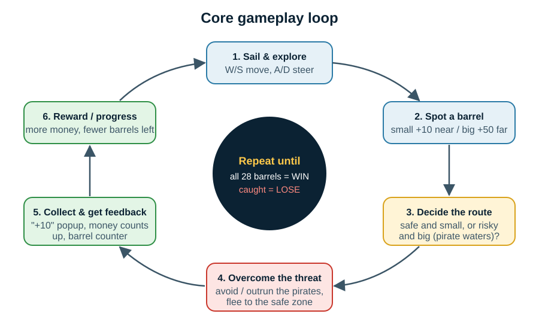
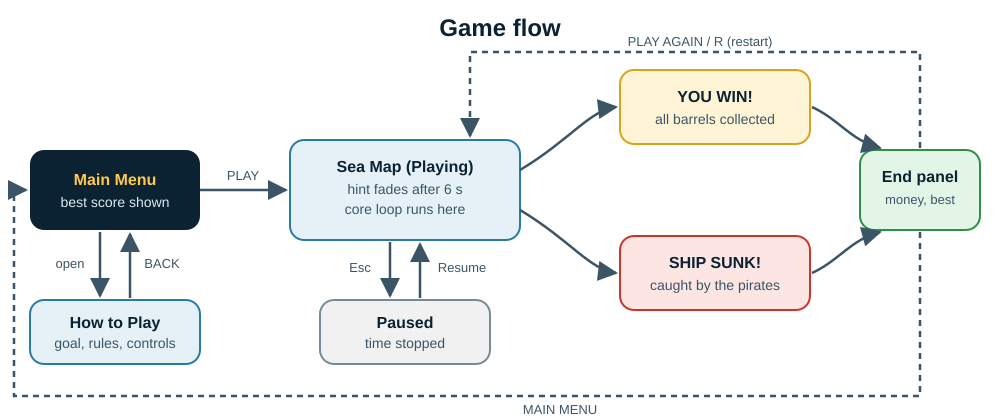

# Boat Game - Game Design Document (Midterm)

**From game idea to a testable prototype**

| | |
|---|---|
| **Working title** | Boat Game |
| **Course** | Game Design |
| **Instructor** | _[TO FILL]_ |
| **Team** | _[TO FILL: name - student ID, for each member]_ |
| **Submission date** | _[TO FILL]_ |
| **Repository** | https://github.com/MalekHossam-2006/boatgame |
| **Prototype** | Unity 6000.4.7f1 project (`Assets/Scenes/MainMenu.unity`) + Windows build |

> Draft status: sections marked **[TO FILL]** need information only the team has
> (names, IDs, playtest results). Everything else describes the prototype as it is
> in the repository. Features that are not built yet are marked **Planned**.

---

## 1. Game concept and pitch

**Genre:** 3D arcade sailing / collection game with light evasion (single player).

**One-sentence pitch:** Sail a small pirate boat across a dangerous sea, grabbing
floating barrels of gold while outrunning the pirate ship that guards the richest waters.

**Overview:** The player steers a small ship around a circular sea full of islands
and rocks. Money barrels float everywhere: small ones near the start are safe and
worth +10, and big spinning ones far out near the map edge are worth +50. A bigger
pirate ship patrols those outer waters. If it sees you, it chases you, and if it
catches you, your ship sinks. A ring of red buoys around the start marks a safe zone
the pirates will not enter. The game is interesting because every trip outward is a
small gamble: *how greedy can I be before I have to run home?*

**Theme, setting and player role:** a sunny, low-poly tropical sea. The player is
the captain of a small treasure-hunting boat. **Narrative premise:** a merchant fleet
lost its cargo in a storm, and the barrels are drifting across pirate-controlled
waters. Grab as much as you can before the pirates catch you.

**Hook / unique selling point:** a simple, readable **risk-versus-reward map**. Value
grows with distance from safety, and so does danger. One enemy with clear rules
(patrol, chase, give up) creates tension without combat or complicated controls.

## 2. Target audience, platform and player goals

| | |
|---|---|
| **Target audience** | Casual players aged 10+, including people who rarely play. Sessions are short (3-8 minutes), and the controls are 4 keys. |
| **Platform** | PC (Windows), keyboard + mouse. Made in Unity 6 (URP). |
| **Player goal** | Collect all 28 barrels (maximum 520 money) and beat your best score. |
| **Win condition** | Every barrel collected: "YOU WIN!" |
| **Lose condition** | The pirate ship catches you: your ship sinks, "SHIP SUNK!" |
| **Main challenge** | Reach the valuable outer barrels and get back without being caught. The pirate ship is slower than you (8 vs 10), so you can escape if you react early, but islands and bad turns can trap you. |

### Scope

**Included in the final version:**

- One complete sea map with the current rules, tuned after playtesting.
- Main menu, how-to-play, pause, win/lose screens, best score (**done**).
- Sound effects and music (**Planned**).
- Spending money on simple ship upgrades, for example speed or turning (**Planned**).
- A second enemy behaviour or a second map / harder layout for progression (**Planned**).

**Left out on purpose:** ship-to-ship combat and cannons, multiplayer, a story
campaign, open-world exploration, character customisation. They do not support the
core "grab and run" loop and would not fit the semester's time.

## 3. Game design principles

### 3.1 Clear goals and rules
| | |
|---|---|
| **Design decision** | The main menu has a How to Play card (goal, barrel values, the pirate, the safe zone, controls). In game, a hint bar repeats the rules for 6 seconds. The HUD always shows money and "barrels collected / 28". The win and lose screens say exactly what happened. |
| **Effect on the player** | The player knows what to do in the first seconds, always knows how much is left, and understands why a run ended. |
| **How to test** | After 30 seconds of play, ask "What is the goal? What happens if the big ship touches you?" Also measure how long it takes to collect the first barrel. |

### 3.2 Meaningful choices and agency
| | |
|---|---|
| **Design decision** | Barrel value depends on location. The 22 small barrels (+10) sit 12-70 units from the start, and the 6 big barrels (+50) sit 60-87 units out, inside the pirate's patrol ring (radius 80). The safe zone (radius 28) is the only fully safe place. |
| **Effect on the player** | Each trip is a real decision: clear the safe area first, or risk an early trip for +50. The player picks the route, the timing (waiting for the pirate to pass), and when to give up and flee. |
| **How to test** | Log which barrels players take first and how many +50 attempts end in a loss. Ask "Did going for the big barrels feel worth it?" |

### 3.3 Challenge, balance and fairness
| | |
|---|---|
| **Design decision** | The pirate is **slower** (max speed 8 vs 10) and **turns slower** (55 vs 70 deg/s). It only starts chasing within 25 units and gives up beyond 45. It never enters the safe zone. It catches you only within 4.5 units. It steers around islands, so it cannot be cheesed easily. |
| **Effect on the player** | Getting caught feels like your own mistake (late reaction, getting pinned against an island), not bad luck. Escape is always possible with good play, which keeps tension high but fair. |
| **How to test** | Count catches per run and ask "When you were caught, did it feel fair?" If most players say no, raise the player's speed edge or lower the detect range. These numbers are exposed in the Inspector for tuning. |

### 3.4 Feedback and responsiveness
| | |
|---|---|
| **Design decision** | Every important event has an immediate signal. **Pickup:** a gold "+10" rises from the barrel, the money counter counts up, and the money pill "pops". **Danger:** a red pulsing "PIRATES ARE CHASING YOU!" banner. **Loss:** the ship visibly sinks and tips over, then the end panel appears. The ship model tilts on the waves and leans into turns, so steering feels responsive. |
| **Effect on the player** | The player never wonders whether something happened. The chase banner warns before it is too late, which supports fairness (3.3). |
| **How to test** | Ask "Did you notice when the pirates started chasing you?" and watch whether players turn away when the banner appears. |

### 3.5 Pacing, onboarding and learning curve
| | |
|---|---|
| **Design decision** | Difficulty grows with distance. The player starts inside the safe zone with small barrels nearby, so the controls can be learned with no danger. The threat only exists in the outer ring. |
| **Effect on the player** | The first minute teaches movement and collection. The tension rises when the player chooses to leave. Players control their own pacing. |
| **How to test** | Note how long first-time players stay inside the buoys before going out, and whether anyone is caught in the first minute. |

## 4. MDA analysis

**Target aesthetics:** **Challenge** (primary: tension, escaping, beating your best
score), **Fantasy** (being a small sea captain on a bright tropical sea), and
**Discovery** (exploring the map to find barrels and safe routes).

| Mechanics (rules / systems) | Dynamics (player behaviour) | Aesthetics (experience) |
|---|---|---|
| **Example 1 - The pirate guard.** A pirate ship patrols a circle of radius 80, chases within 25 units, gives up beyond 45, never enters the safe zone (radius 28), is slower than the player (8 vs 10), and sinks the player on contact. | Players **scout** where the pirate is, **wait** for it to pass, **dash** in for a barrel, then **flee** toward the buoys. They use islands to break the chase (or get trapped by them). Near-escapes happen often. | **Challenge** and **tension**: the relief of reaching the buoys just in time. The fair speed difference turns a loss into "one more try". |
| **Example 2 - Value grows with danger.** Barrels are worth +10 near the start and +50 far out inside the patrol ring. All 28 are needed to win, and the best score is saved between sessions. | **Risk-taking and route planning:** clear the safe area first or gamble early. Players weigh greed against safety on every trip, and **replay** to collect more money than last time. | **Challenge** (self-competition with the best score) and **Discovery** (learning the map, finding efficient routes). |
| **Example 3 - Readable feedback and a living sea.** Animated low-poly waves, the ship tilts and leans, "+N" popups, money count-up, chase banner, sinking animation. | Players **react quickly** to danger and **chain pickups** to watch the counter climb. They spend time just sailing along islands. | **Fantasy / sensation** of sailing, and satisfaction from every pickup. |

**Why these mechanics should create these aesthetics:** the enemy rules make danger
predictable (always the outer ring, always slower than you), so players can plan and
take risks on purpose. Planned risk is what makes success feel earned (Challenge).
Putting the highest value exactly where the danger is ties the reward system to the
threat, so the two mechanics produce one dynamic (greed vs safety) instead of two
separate activities.

## 5. Core gameplay loop and game flow

**What the player does repeatedly:** sail out, pick a barrel, judge the risk, collect
it, escape if chased, and return to safety. **Why they keep going:** every barrel makes
the money counter grow, fewer barrels remain, and the remaining ones are the
dangerous, valuable ones. So the loop gets tenser toward the end of a run. The saved
best score gives a reason to replay.

**Game flow:**

1. **Start / onboarding:** Main Menu (best score) and How to Play (goal, rules,
   controls), then PLAY. In the level, the hint bar shows for 6 seconds.
2. **Main gameplay:** the core loop on the sea map. Esc pauses (Resume / Restart / Main Menu).
3. **Success / failure:** all barrels gives "YOU WIN!". Caught gives the ship sinking and "SHIP SUNK!".
   The end panel shows money, barrels and best score.
4. **Restart / next step:** PLAY AGAIN (or R) restarts the level, and MAIN MENU goes back to the menu.

**Controls:**

| Input | Action |
|---|---|
| W / Up arrow (hold) | Sail forward |
| S / Down arrow (hold) | Slow down / reverse |
| A / D or Left / Right | Steer |
| Mouse wheel | Zoom camera |
| Esc | Pause / resume |
| R | Restart level |
| Mouse / Enter | Menu buttons |

## 6. Prototype overview

**Type:** playable digital build (Unity 6000.4.7f1, Universal Render Pipeline).

**What the prototype demonstrates:**

- The main actions: sailing, steering, collecting barrels.
- A challenge and a decision: the pirate guard and the value-vs-danger barrel layout.
- Goal communication and feedback: menu, hint, HUD, popups, chase banner, end screens.
- A complete flow: menu, play, pause, win/lose, replay.

**How to run:**

- **Windows build:** unzip and run `BoatGame.exe` (no Unity needed).
- **Unity project:** install Unity **6000.4.7f1**, open the repository folder in Unity
  Hub, open `Assets/Scenes/MainMenu.unity`, press Play. Full steps are in `README.md`.

**Screenshots:**

| | |
|---|---|
|  |  |
|  |  |
|  |  |

**Technical notes:** scenes are generated by editor scripts
(`Tools > Boat Game > Build Sea Map / Build Main Menu`), so the level layout is
reviewable as code. Every development step is documented in `docs/DEVLOG.md` and
matches one git commit.

## 7. Playtesting findings and planned improvements

> **[TO FILL after the playtest sessions.]** The test plan, questions and observation
> sheet are in `docs/PLAYTEST.md`. Results must come from real testers (at least two people).

**Questions for playtesters:**

1. "Was the goal clear within the first minute?"
2. "Did going for the big +50 barrels near the pirate feel like a meaningful choice?"

**Observations:** _[TO FILL: at least three observations or quotes]_

| # | Tester | Observation / feedback |
|---|---|---|
| 1 | | |
| 2 | | |
| 3 | | |

- **One thing that worked:** _[TO FILL]_
- **One problem or confusion point:** _[TO FILL]_
- **One change we plan to make:** _[TO FILL]_

**Internal review notes (team, before external playtesting):**

- The pirate ship uses a similar brown model to the player's ship (only bigger).
  New players might confuse them. We will ask testers about this and, if needed,
  recolour the pirate ship or give it red sails.
- Enemy speed and ranges are first estimates and will be tuned with the playtest data.

## 8. Work completed, remaining tasks and end-of-term plan

**Completed (midterm):**

- Sea map with islands, rocks, map edge and animated ocean.
- Simple ship controls, top-down follow camera.
- 28 money barrels with two values, money/score system, best score.
- Pirate enemy (patrol / chase / give up / catch), safe zone, lose condition with sinking.
- Main menu, how to play, HUD, pause, win/lose screens.
- README, development log (`docs/DEVLOG.md`), this GDD, diagrams, Windows build.

**Remaining before the midterm submission:**

- Playtest with at least two people and fill section 7 **[team]**.
- Sketch / storyboard and reference images (visual evidence section) **[team]**.
- 1-3 minute gameplay video **[team]**.
- Team names, IDs and contribution summary **[team]**.

**End-of-term plan:**

1. Apply playtest feedback (enemy tuning, enemy readability).
2. Sound effects and music.
3. Ship upgrades bought with money (speed / turning / pickup radius) to add progression.
4. Extra content for replayability: a harder map or a second enemy behaviour.
5. Accessibility and usability pass: remappable keys, UI scale, colour-blind-safe danger cue.
6. Second playtest round, fixes, final build, gameplay video, final document and presentation.

## 9. Team contribution

_[TO FILL: see `docs/TEAM.md`.]_

## 10. References and credits

- **Inspiration (idea only, no assets used):** *Privateers: Pirate Wars* (mobile naval
  game, Google Play `com.madfatcat.privateers`). We borrowed the general setting of
  sailing a pirate ship on a low-poly sea, not its mechanics, art, name or code. Our
  game has no combat. Its core is collection plus evasion.
- **3D models:** Pirate Kit by Kenney, https://kenney.nl/assets/pirate-kit, CC0 license.
- **Fonts:** Bangers and Oswald, SIL Open Font License, from the TextMesh Pro examples included with Unity.
- **Engine and packages:** Unity 6 (6000.4.7f1), Universal Render Pipeline, Input System, TextMesh Pro / uGUI.
- **Framework:** Hunicke, R., LeBlanc, M., Zubek, R. (2004). *MDA: A Formal Approach to
  Game Design and Game Research.* AAAI Workshop on Challenges in Game AI.
- **Our own earlier work:** ocean, camera, ship movement and scene-builder code adapted
  from the team's earlier pirate prototype.
- **AI assistance:** code, documentation drafts and diagrams were produced with help from
  an AI assistant (Claude by Anthropic) and reviewed and tested by the team. See `docs/DEVLOG.md`.
